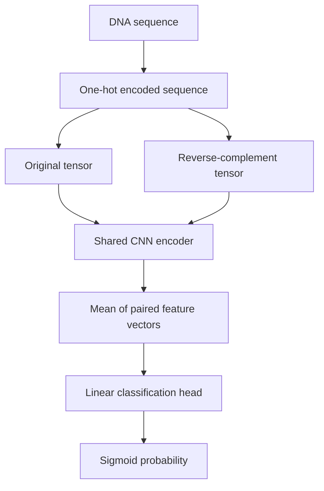
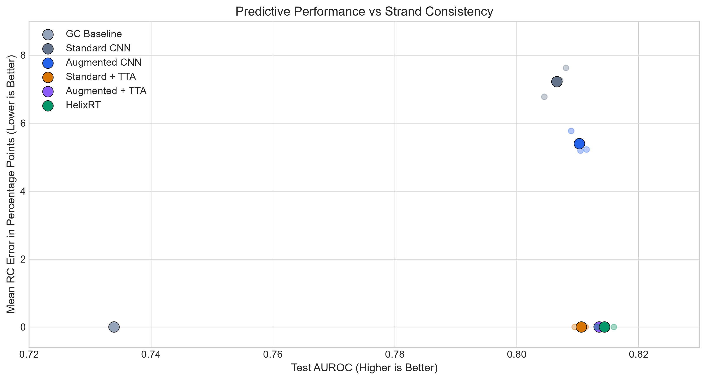
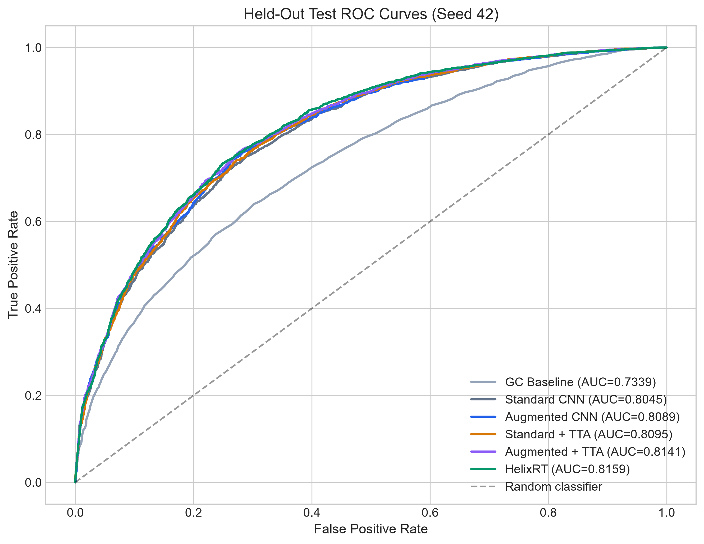
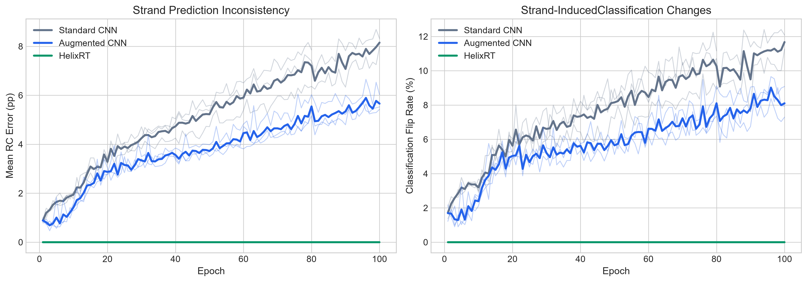
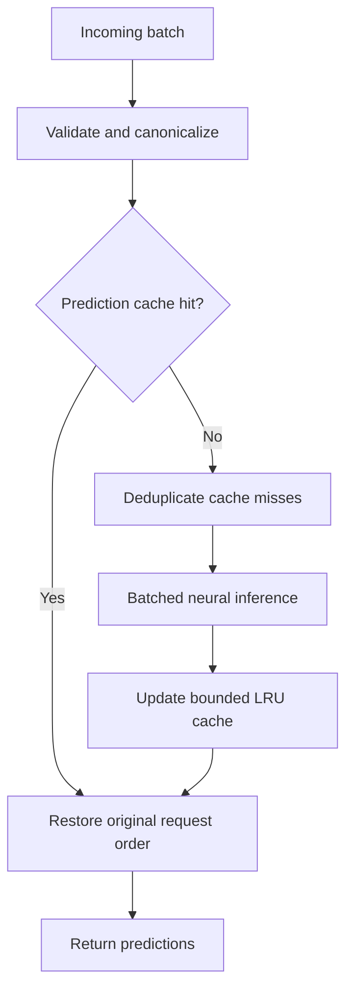

# HelixRT

**Symmetry-aware genomic deep learning and inference optimization**

  

HelixRT investigates how a known biological symmetry can be incorporated into a neural network and subsequently exploited to reduce redundant inference. The application is human enhancer classification from 500-base-pair DNA sequences.

The current implementation achieves **0.8144 mean held-out test AUROC** across three training seeds and **zero observed reverse-complement prediction disagreement**. A conventional CNN achieves 0.8065 AUROC and changes its classification for 10.62% of test inputs when their strand representation is reversed.

The deep learning experiments and inference engine are implemented. In a controlled 12-request demonstration using a trained checkpoint, canonical caching and batch deduplication reduced model sample evaluations from 12 to 2 (83.33%) while preserving predictions within a numerical tolerance of $10^{-6}$. Full CPU and GPU runtime benchmarks are pending.

## Motivation

DNA is double-stranded. A sequence and its reverse complement describe the same double-stranded segment when read in opposite orientations. For strand-independent enhancer classification, both representations should receive the same prediction.

```text
Original sequence:   ATGCCA
Reverse complement:  TGGCAT
```

Conventional CNNs do not guarantee this property. Reverse-complement augmentation encourages consistency during training, but does not enforce it mathematically.

HelixRT addresses this through shared-weight feature extraction and symmetric aggregation. The resulting invariance provides a correctness guarantee that can be used for canonical caching and batch deduplication in an inference system.

## Architecture



The encoder consists of two one-dimensional convolutional layers, max pooling and global average pooling. All CNN configurations use the same backbone and contain 16,417 trainable parameters.

| Layer                                 | Output per sequence |
| ------------------------------------- | ------------------- |
| One-hot input                         | 4 × 500             |
| Conv1d (32 filters, kernel 15) + ReLU | 32 × 500            |
| MaxPool1d (kernel 2)                  | 32 × 250            |
| Conv1d (64 filters, kernel 7) + ReLU  | 64 × 250            |
| Global average pooling                | 64                  |
| Linear classification head            | 1 logit             |

For the invariant architecture, let $\phi$ denote the shared encoder, $g$ the classification head including the sigmoid, and $R$ the reverse-complement operation. The predicted probability is

$$
f(x)=g\left(\frac{\phi(x)+\phi(R(x))}{2}\right).
$$

Since $R(R(x))=x$, reversing the input orientation only exchanges the operands of the mean. Thus $f(R(x))=f(x)$ in exact arithmetic. Deterministic floating-point inference may introduce negligible numerical differences.

The invariant model concatenates original and reverse-complement tensors along the batch dimension before encoding them. It shares all parameters across strands, although it performs two encoder sample evaluations for each unique input.

## Dataset and preprocessing

[Human Enhancers Cohn (Genomic Benchmarks)](https://huggingface.co/datasets/katarinagresova/Genomic_Benchmarks_human_enhancers_cohn) provides a binary classification task with balanced classes and fixed-length DNA sequences.

| Split         | Sequences |
| ------------- | --------: |
| Training      |    17,716 |
| Validation    |     3,127 |
| Held-out test |     6,948 |
| Total         |    27,791 |

The original training split was partitioned using stratified sampling with seed 42. The official test split was preserved. Exact duplicates, reverse-complement equivalents, conflicting labels and cross-split canonical overlap were audited. No exact or reverse-complement overlap was detected in the prepared splits. This audit does not exclude overlap between highly similar genomic regions.

Sequences are encoded as four-channel float32 tensors in A, C, G, T order. The sequence utilities also support ambiguous `N` bases as all-zero columns, though the inspected benchmark contains no such bases.

## Experimental design

Three CNN configurations were trained with seeds 42, 123 and 456. Each used AdamW, binary cross-entropy with logits, batch size 128, learning rate 0.001, weight decay 0.0001, a maximum of 100 epochs and early stopping patience of 15 epochs. Checkpoints were selected by validation AUROC. Training was conducted on an NVIDIA RTX 4070 laptop GPU; held-out evaluation ran on CPU.

| Configuration          | Symmetry handling                                                              |
| ---------------------- | ------------------------------------------------------------------------------ |
| GC logistic regression | Strand-invariant nucleotide composition feature                                |
| Standard CNN           | No explicit constraint                                                         |
| Augmented CNN          | Random reverse-complement replacement during training                          |
| Standard CNN + TTA     | Mean of original and RC probabilities at inference                             |
| Augmented CNN + TTA    | Training augmentation plus inference averaging                                 |
| HelixRT                | Shared encoder and symmetric feature aggregation during training and inference |

TTA configurations reuse the trained CNN checkpoints. In total, nine neural network training runs and 16 test evaluations produced 111,168 sequence-level prediction records.

## Results

Held-out results are means across three seeds, except for the single-run GC baseline. AUROC variability is reported as sample standard deviation. Classification metrics use a probability threshold of 0.5. RC error is the mean absolute probability difference in percentage points.

| Model           |   AUROC (mean ± SD) |   Accuracy |         F1 | Mean RC error (pp) | RC flip rate |
| --------------- | ------------------: | ---------: | ---------: | -----------------: | -----------: |
| GC baseline     |        0.7339 (N/A) |     66.91% |     0.6592 |               0.00 |        0.00% |
| Standard CNN    |     0.8065 ± 0.0018 |     72.90% |     0.7349 |               7.22 |       10.62% |
| Augmented CNN   |     0.8103 ± 0.0013 |     73.08% |     0.7218 |               5.40 |        8.10% |
| Standard + TTA  |     0.8106 ± 0.0010 |     72.94% | **0.7352** |               0.00 |        0.00% |
| Augmented + TTA |     0.8135 ± 0.0005 |     73.47% |     0.7264 |               0.00 |        0.00% |
| **HelixRT**     | **0.8144 ± 0.0014** | **73.68%** |     0.7345 |           **0.00** |    **0.00%** |

The standard CNN changed its predicted class for an average of 738 out of 6,948 test sequences per seed. Augmentation reduced this to approximately 563. HelixRT had zero observed flips across all three runs (20,844 sequence-run observations).

All CNNs outperform the GC baseline in AUROC, suggesting that sequence-dependent features provide additional predictive information. HelixRT achieves the highest observed mean AUROC, but its advantage over augmented TTA is only about 0.0009; statistical superiority has not been established. Zero RC error is a consequence of the architecture, not a measure of perfect classification.

### Experimental artifacts

- [Individual test metrics](results/test_metrics.csv)
- [Aggregated model comparison](results/model_comparison.csv)
- [Per-sequence test predictions](results/test_predictions.csv)
- [Model comparison notebook](notebooks/03_model_comparison.ipynb)





## Symmetry-aware inference engine

The implemented engine exploits invariance using a canonical sequence key:

$$
k(x)=\min_{\mathrm{lex}}(x,R(x)).
$$

Both orientations map to the same key, permitting safe prediction reuse for a fixed invariant model within numerical tolerance.



### Execution modes

| Mode              | Persistent cache | Canonical keys | Within-batch deduplication |
| ----------------- | ---------------- | -------------- | -------------------------- |
| `none`            | No               | No             | No                         |
| `exact`           | Yes              | No             | No                         |
| `canonical`       | Yes              | Yes            | No                         |
| `canonical_dedup` | Yes              | Yes            | Yes                        |
| `dedup_only`      | No               | Yes            | Yes                        |

The engine supports ordinary CNN inference, test-time reverse-complement averaging (TTA), and the invariant CNN. Canonical modes reject ordinary non-invariant CNN inference because sharing predictions between strands would otherwise alter model behavior.

Each engine owns a bounded LRU cache scoped to a fixed model instance. A dictionary groups equivalent pending requests, and their original indices are retained to restore output order after batched inference. Cache hits and within-batch duplicates are counted separately. All inputs are validated before cache lookup, and the model runs in evaluation and inference mode.

### Algorithmic complexity

For $N$ incoming sequences of length $L$, $U$ unique uncached canonical keys, cache capacity $C$, and model sample evaluation cost $F(L)$, the optimized engine requires approximately $O(NL + UF(L))$ computational work, compared with $O(NL + NF(L))$ for unoptimized end-to-end inference. Canonicalization and hashing require linear work in sequence length; LRU operations and dictionary lookups have expected constant-time cost after key hashing. Cache storage is $O(CL)$, excluding model weights and temporary inference tensors. This analysis describes computational work, not wall-clock execution time on parallel hardware.

### Trained-model inference demonstration

A workload of six requests containing two distinct underlying DNA segments was submitted twice to each engine mode, starting with an empty cache of capacity 128. The demonstration used the trained invariant CNN (seed 42, checkpoint selected by validation AUROC) on CPU. All modes returned numerically equivalent predictions within an absolute tolerance of $10^{-6}$.

| Mode                      | Requests | Cache hits | Batch duplicates eliminated | Model sample evaluations | Encoder sample evaluations | Final cache entries |
| ------------------------- | -------: | ---------: | --------------------------: | -----------------------: | -------------------------: | ------------------: |
| Uncached                  |       12 |          0 |                           0 |                       12 |                         24 |                 N/A |
| Exact cache               |       12 |          6 |                           0 |                        6 |                         12 |                   4 |
| Canonical cache           |       12 |          6 |                           0 |                        6 |                         12 |                   2 |
| Canonical + deduplication |       12 |          6 |                           4 |                    **2** |                      **4** |               **2** |
| Deduplication only        |       12 |          0 |                           8 |                        4 |                          8 |                 N/A |

The fully optimized engine avoided 10 of 12 model sample evaluations (83.33%), or 20 of 24 encoder sample evaluations. Canonical caching also occupied half as many cache entries as exact caching. These results describe a deliberately redundant demonstration, not a representative production workload, measured memory savings in bytes, or a runtime speedup.

The invariant CNN processes two strand representations per logical model sample. A standard CNN processes one. TTA also provides a valid basis for canonical caching and is a competitive alternative. Runtime measurements are needed to determine whether the reduction in neural computation offsets preprocessing and cache overhead.

### Performance benchmarking (pending)

The planned benchmark suite will compare the five engine modes using the same frozen invariant checkpoint, alongside conventional CNN and augmented TTA baselines (including optimized TTA). An exact-key deduplication control is desirable to separate the benefits of generic duplicate detection from biological symmetry.

Experiments will vary request redundancy, duplicate type, request batch size, cache capacity and initial cache state. CPU and GPU measurements will report sequences per second, p50 and p95 batch completion latency, cache hits and evictions, and model and encoder sample evaluations. Workloads will use reproducibly generated request streams from real genomic sequences; GPU timing will include synchronization and model warm-up outside measured runs.

No wall-clock performance improvements or empirical break-even points are claimed yet.

## Reproducing the experiments

### 1. Environment

Clone this repository and run commands from its root. Python 3.11 is the recommended starting environment.

```bash
python -m venv .venv
```

Activate on Windows Command Prompt:

```cmd
.venv\Scripts\activate
```

On Linux or macOS:

```bash
source .venv/bin/activate
```

Install dependencies and a hardware-appropriate PyTorch build using the [official PyTorch installation guide](https://pytorch.org/get-started/locally/).

```bash
python -m pip install -r requirements.txt
python -c "import torch; print(torch.__version__); print(torch.cuda.is_available())"
```

### 2. Prepare the dataset

Run `notebooks/01_data_exploration.ipynb`, including its preprocessing and split-export steps. Ensure that the resulting CSVs are named `train.csv`, `val.csv` and `test.csv` in `data/processed/`, each containing `seq`, `label` and `gc_content` columns. Use the original dataset and seed-42 stratified 85:15 split of the official training data. If the notebook exports `validation.csv`, rename it to `val.csv` to match the current data loader.

Run `notebooks/02_baseline_experiments.ipynb` to reproduce the GC validation baseline.

```bash
python -m src.dataset
python -m pytest tests/ -v
```

### 3. Train the CNNs

Example for one configuration and seed:

```bash
python -m src.train --model invariant --epochs 100 --batch-size 128 --learning-rate 0.001 --patience 15 --seed 42 --num-workers 0
```

Repeat using `standard`, `augmented` and `invariant` with seeds `42`, `123` and `456`. The training script selects CUDA automatically when available. On Windows, `scripts/train_all.bat` can automate runs; inspect it before execution because the development version may skip the already completed standard seed-42 experiment.

Checkpoints are saved locally under `checkpoints/`; epoch histories are saved under `results/`. Data and checkpoint files are excluded from Git. To evaluate on another machine, transfer all nine checkpoint files or reproduce training.

### 4. Evaluate frozen checkpoints

```bash
python -m src.evaluate --device cpu --batch-size 128
```

Expected outputs:

| File                           |    Rows |
| ------------------------------ | ------: |
| `results/test_metrics.csv`     |      16 |
| `results/model_comparison.csv` |       6 |
| `results/test_predictions.csv` | 111,168 |

The GC baseline has undefined sample standard deviation because it has one run. This is expected. Run `notebooks/03_model_comparison.ipynb` to regenerate figures from the saved predictions and histories.

### 5. Verify and use the inference engine

```bash
python -m pytest tests/ -v
python -m scripts.demo_inference
```

The demonstration requires the processed test CSV and `checkpoints/invariant_seed42_epochs100.pt`.

To use the engine programmatically from the repository root:

```python
from src.inference import InferenceEngine
from src.sequence import reverse_complement

engine = InferenceEngine.from_checkpoint(
    model_name="invariant",
    seed=42,
    epochs=100,
    device="cpu",
    mode="canonical_dedup",
    cache_capacity=1024,
    batch_size=128,
)

# Synthetic diagnostic input (not a biological prediction example).
sequence = "ATGCCA" * 83 + "AT"
predictions = engine.predict([sequence, reverse_complement(sequence)])
print(predictions)
print(engine.stats())
```

The two equivalent requests should return the same probability while requiring one logical model sample evaluation. Subsequent requests can reuse the cached result.

## Repository layout

```text
HelixRT/
├── data/processed/           # Generated locally
├── notebooks/
│   ├── 01_data_exploration.ipynb
│   ├── 02_baseline_experiments.ipynb
│   └── 03_model_comparison.ipynb
├── src/
│   ├── sequence.py
│   ├── dataset.py
│   ├── models.py
│   ├── train.py
│   ├── evaluate.py
│   ├── cache.py
│   └── inference.py
├── scripts/
│   ├── train_all.bat
│   └── demo_inference.py
├── tests/
│   ├── test_sequence.py
│   ├── test_models.py
│   ├── test_cache.py
│   └── test_inference.py
├── checkpoints/             # Generated locally
├── results/
├── requirements.txt
└── README.md
```

Upcoming benchmark artifacts: `benchmarks/workload.py`, `benchmarks/benchmark_inference.py`, `tests/test_benchmark.py`, and `notebooks/04_inference_benchmarks.ipynb`.

## Limitations

The current study uses one human enhancer benchmark and three training seeds. It does not establish generalization to other organisms or experimental conditions, statistical significance of small AUROC differences, or biological causality of learned features. Equal parameter counts do not imply equal training or inference compute. TTA's recorded RC consistency is calculated by averaging the same independently generated predictions in both orders; the inference engine includes a standalone TTA consistency test, while trained-checkpoint performance benchmarking remains pending. Exact reproducibility across hardware is not guaranteed. The engine is synchronous and single-threaded at the request level, uses full sequence strings as keys, and bounds cache entries rather than memory bytes. Cache insertions for misses occur after batch execution, so recency semantics differ from strictly sequential LRU. Cached values assume fixed model weights and configuration. The demonstration verifies a small redundant workload; it does not establish runtime benefits or production readiness.

## Research foundations

- [Genomic Benchmarks](https://github.com/ML-Bioinfo-CEITEC/genomic_benchmarks): genomic sequence classification datasets and benchmark tooling.
- Zhou, Shrikumar and Kundaje (2022), [Towards a Better Understanding of Reverse-Complement Equivariance for Deep Learning Models in Genomics](https://proceedings.mlr.press/v165/zhou22a.html).
- [Reverse-Complement Equivariant Networks for DNA Sequences](https://research.google/pubs/reverse-complement-equivariant-networks-for-dna-sequences/).

HelixRT builds on established reverse-complement symmetry techniques. Its engineering objective is to connect their correctness properties with measurable inference-system optimizations.
